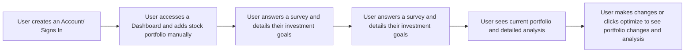
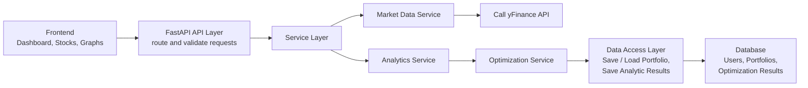

# Optify

Portfolio Optimization for Retail Investors

## Project Description

Retail investors have a wide variety of stockbrokers and derivatives to invest in, but many do not have access to education or knowledge of optimizing their portfolio based on their life goals. Some may look to be riskier in their investments, while others may like to have less exposure to risk. An investment advisor could offer valuable advice on which financial assets to invest in, whereas this tool can answer the question of how much money a user should allocate based on their desired goals. The purpose of this project is to help retail investors make smarter decisions while building a strong portfolio of financial assets.

## OKR - End Users

For this project, the end users would ideally be for all retail investors in the United States. The reason for this scope is because the US stock market is the largest in the world, and stock market data can be obtained easily through open-source libraries like YFinance, a library that provides access to a wide variety of data. This tool would be most helpful to those that wish to diversify their portfolio.

To go a little further, I would break retail investors into these groups:

- Beginner Retail Investors: New investors with little to no stock knowledge.
- Independent Retail Investors: Investors that pick stocks on their own.
- Retail Investors looking to Invest in a New Asset: Investors that want to add a new asset (e.g., when a stock is undervalued).
- Retail Investors Looking to Cut Their Portfolio: Investors that want to reduce their portfolio (e.g., when a stock is overvalued).
- Retail Investors Looking to Rebalance Their Portfolio: Investors looking to change their portfolio.

## OKR - Solution Discovery

For this, solution discovery could be made by interviewing retail investors like parents, students, and professors to see if there’s any common ground or pain points that need to be specifically addressed. This would be helpful to see what they currently use/do for investing in financial assets. It would also be helpful to see what type of goals they are looking to achieve and how portfolio optimization can help achieve that. This would also help determine how retail investors are making decisions based on what they buy or sell and at what size.

## KPIs

- 100 % of users should be able to create a portfolio
- At least 80 % of users should be able to see an optimized portfolio that’s better than their previous portfolio.
- The calculations should be at least 90 % accuracy

## OKR - Approaches and Tradeoffs

Given the wide variety of financial assets, the scope of this project would focus specifically on U.S. based stocks and the problem of diversifying stock portfolios. As a stretch goal, it could expand to other financial assets.

### Paper Trading Simulator:

- Approach: A paper trading simulator could be built to see how a portfolio performs in the long term with fake money based on pre-existing data or live data from an API.
- Tradeoff: It could be hard to do, and obtaining data could cost money while there are free plans like Alpaca API, but it is not comprehensive. Also, many paper trading platforms already exist like thinkorswim, TradingView, Webull, etc. There would be no real point in recreating something that already exists.

### Portfolio Optimization Dashboard:

- Approach: A dashboard where a user can pick specific stocks to include on their portfolio and be able to determine the specific weights or distributions of the stocks that they should have. The application would analyze the portfolio and optimize it. This tool should also visualize the effectiveness of a set period of historical data.
- Tradeoff: The information can be hard to consume for beginners and those without investment knowledge. It can also be hard to obtain all of the data needed for this tool. This tool offers more control for the user compared to an agentic investor, and has a retail investment focused feature that differentiates from a traditional paper trading application.

### Agentic Investor:

- Approach: An AI agent would be responsible for making the decisions to invest in which stocks to have and have the authority to make these decisions on behalf of the investor.
- Tradeoff: It would be dangerous and foolish to let an AI invest without human supervision. This would also cost a lot of money if the model supporting the agent went down, and there was an open position that shouldn’t be open. The outputs can also be nondeterministic and there would be other factors that the AI would not be able to consider like news. Running the model can also be costly if it’s doing a lot of research and burning tokens.

## Workflow Diagram

### High Level Workflow

## Major Features - MVP Phase (9/10 – 10/15)

### Stock Selection (3 days):

- Requirement: Users choose the stocks they are currently investing in or plan to invest in to build their portfolio.
  - The user should be able to search for specific stocks
  - The user should be able to pick stocks for their portfolio
  - The user should be able to add/remove stocks for their portfolio
  - The user shouldn’t be able to pick non-existing stock tickers

### Retrieving Stock Data (3-5 days):

- Requirement: Users should be able to obtain historic data for stocks.
  - The application should retrieve historic stock data
  - The application should handle missing data or edge cases
  - The application should store the data for analysis

### Selecting Historic Periods (1-2 days):

- Requirement: Users should be able to pick the range of historic data for stocks.
  - The user should control what range of time the application should retrieve historic data from.

### Portfolio Calculations (4-5 days):

- Requirement: The application should calculate relevant statistics for portfolio optimization.
  - It should calculate historic daily returns, average returns, annual returns, variance, covariance matrix, and correlation matrix at a bare minimum.
  - It should be properly tested and verified against sample data.

### Portfolio Optimization (1-3 weeks):

- Requirement: The application should generate optimized allocations based on historical data.
  - At a bare minimum, a traditional strategy like Mean-Variance Optimization should be implemented.
    - https://www.investopedia.com/terms/m/meanvariance-analysis.asp
  - More strategies can be added later, where this must be designed to support multiple different optimization strategies and new strategies as they get implemented

## Major Features - Main Build Phase (10/16 – 11/25)

### Optimization Dashboard (1-3 weeks):

- Requirement: The application should have visual support for selecting stocks, picking historical data periods, the portfolio, historic returns, historic volatility, portfolio comparison, sharpe ratio

### Visualizations (3-5 days):

- Requirement: The application should visualize trends and relationships between portfolio optimization results
  - Risk vs. Return

### Portfolio Comparison (1 week):

- Requirement: The user should be able to visually compare two different portfolios (e.g., the previous portfolio and the optimized one)
  - The user should be able to pick two portfolios to compare.

### Custom Constraints (1 week):

- Requirement: The user should be able to add custom constraints based on their risk preference
  - A user could want to have only a set amount of stock
  - A user could want to keep a stock in a portfolio

## Major Features - Stretch Goals Phase (11/26 (or if all major features done) - 12/5 (or end of class))

### Support for Brokerages (1-3 weeks):

- Requirement: A user can connect their stockbroker (e.g., Charles Schwab) and be able to pull in their data from there.
  - Charles Schwab has a developer API that could potentially allow users to connect their portfolio to this project’s dashboard, and users would not have to manually enter their positions.

### Support for Other Financial Assets (1-2 weeks):

- Requirement: A user should be able to optimize their portfolio beyond just stocks (e.g., bonds, real-estate, etc.)
  - Depends entirely on what data is available

## Architectural Diagram

- Intended Technologies:
  - Frontend: React, Tailwind CSS, HTML
  - API: FastAPI
  - Backend: Python
  - Database: PostgreSQL
- Data Collection:
  - Data will be obtained from yFinance or any other python based API to obtain stock data.
- Tradeoffs in Technologies/Frameworks:
  - Frontend: I’m choosing to use React because it’s easy to use and has flexible components. Tailwind CSS also makes it easy to style components and reduces the number of files compared to regular CSS. HTML is needed for the dashboard.
  - API: I’m choosing to use FastAPI over other frameworks because it’s simple to use and has support for better support for concurrency (for multiple users) and data validation (Pydantic) compared to a framework like Flask.
  - Backend: I’m choosing Python over other languages like Java because Python has the best libraries for data analysis like NumPy and Pandas, which are essential for this project.
  - Database: I’m choosing PostgreSQL because the data will be relational and structured. PostgreSQL also works well with Python where there are many libraries like SQLAlchemy that make integration straight forward.
- Design Patterns/Approaches:
  - For portfolio optimization, the strategy pattern will be used to support multiple different optimization strategies that could be added later on.
  - The whole application will use layered architecture separating the frontend, API layer, service layer, data access layer, and database.
- Diagram:

### Project Diagram

